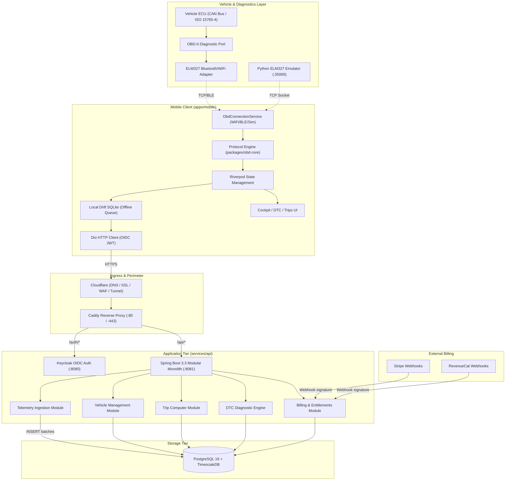
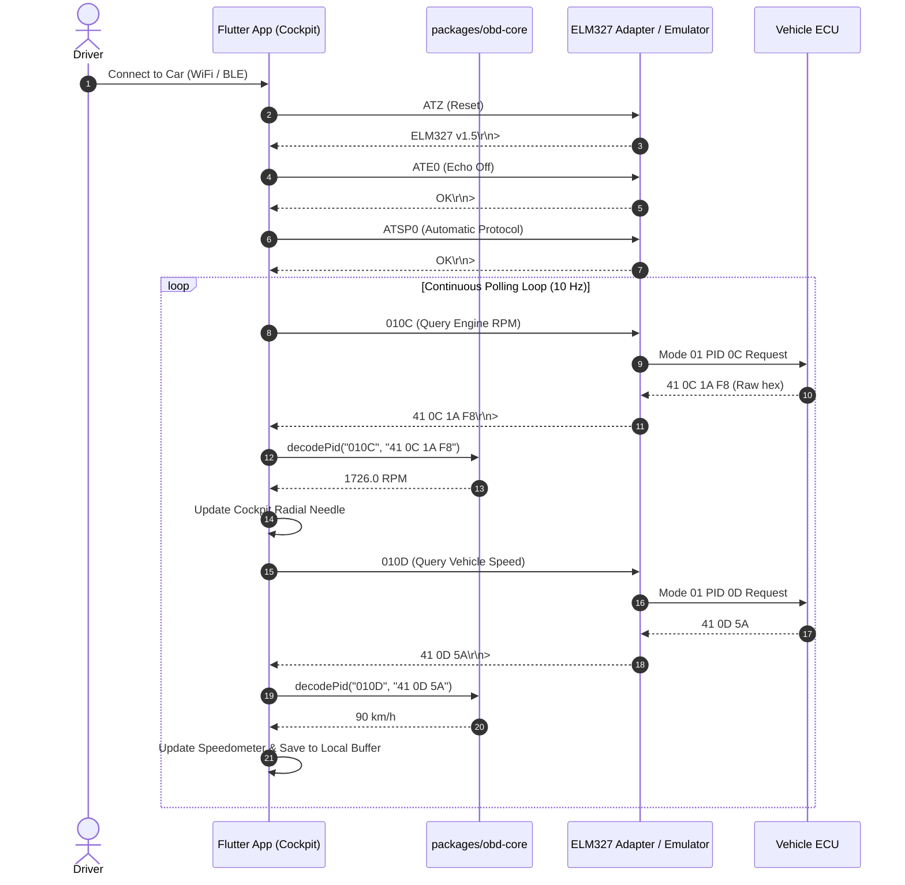
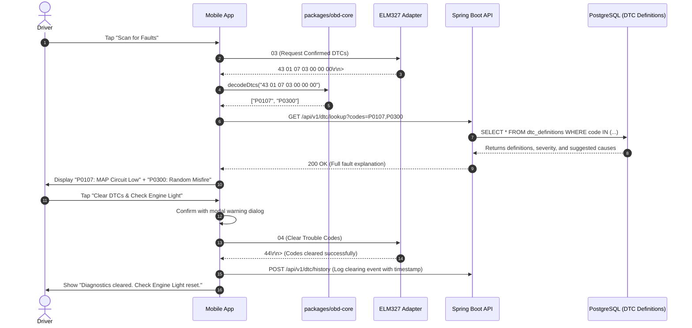
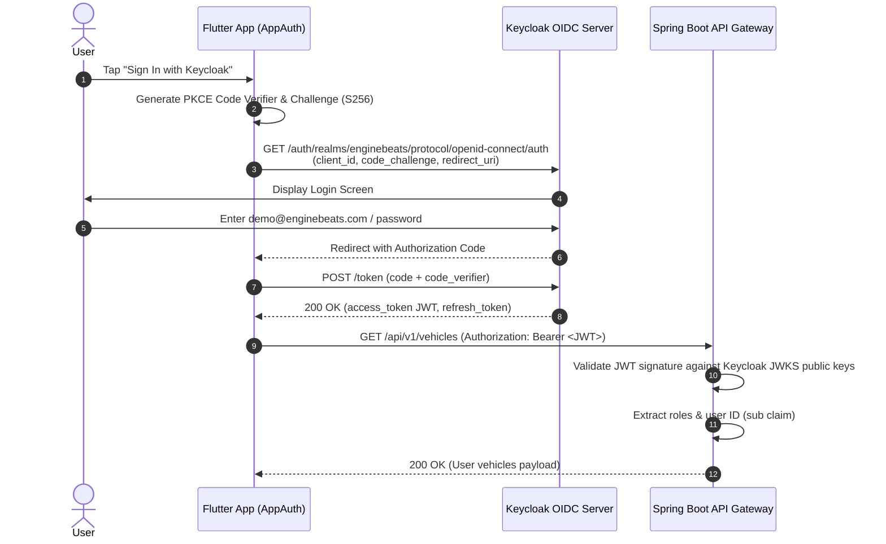
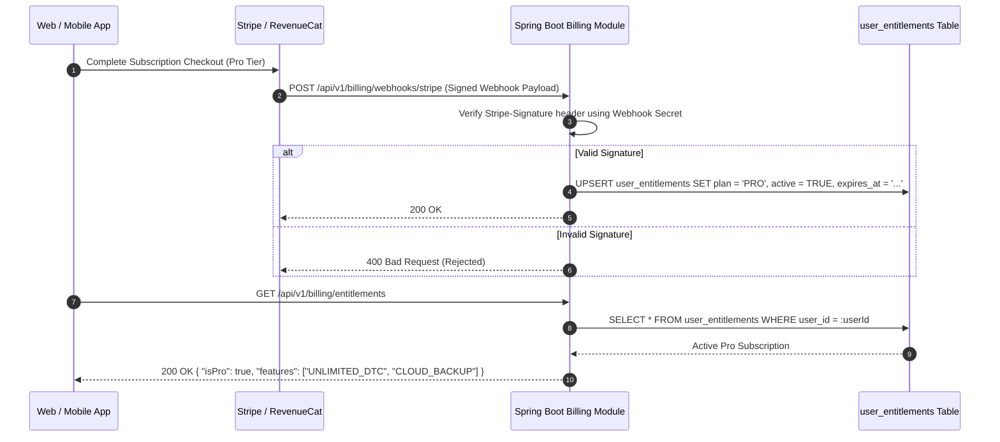

# EngineBeats Architecture Specification

This document provides a comprehensive end-to-end technical explanation of the **EngineBeats** system architecture, data ingestion flows, protocol decoding, security model, and infrastructure deployment topology.

---

## 1. High-Level System Architecture

EngineBeats is built as an offline-first, telemetry-streaming connected vehicle platform. The system spans five main tiers:
1. **Physical Vehicle / ECU Layer**: OBD-II port, CAN bus, ELM327 microcontroller interface.
2. **Mobile Client Layer (Flutter)**: Real-time cockpit dashboard, Riverpod state management, Drift SQLite offline queue, and pure-Dart OBD protocol engine.
3. **Ingress & Security Layer**: Cloudflare (TLS/DDoS) and Caddy reverse proxy routing.
4. **Backend Application Layer**: Spring Boot 3.3 Modular Monolith with Keycloak OIDC authentication.
5. **Data Persistence Tier**: PostgreSQL 16 + TimescaleDB time-series hypertable.



---

## 2. Component Breakdown

### 2.1 Protocol Core Package (`packages/obd-core`)
Located in [packages/obd-core/](file:///home/shankar/project/engine-beats/packages/obd-core), this is a zero-dependency, pure Dart package responsible for serializing ELM327 commands and parsing raw hex byte streams.

- **[elm327_commands.dart](file:///home/shankar/project/engine-beats/packages/obd-core/lib/src/elm327_commands.dart)**:
  - Standard AT setup strings: `ATZ` (Reset), `ATE0` (Echo off), `ATL0` (Linefeeds off), `ATS0` (Spaces off), `ATSP0` (Auto protocol detect).
  - Mode 01 PID queries (e.g., `010C\r` for RPM, `010D\r` for Vehicle Speed).
  - Mode 03 (`03\r`) for reading confirmed Diagnostic Trouble Codes.
  - Mode 04 (`04\r`) for clearing diagnostic codes and resetting the Check Engine Light.
- **[stream_parser.dart](file:///home/shankar/project/engine-beats/packages/obd-core/lib/src/stream_parser.dart)**:
  - Collects streamed TCP/BLE chunked responses, strips prompt characters (`>`), removes noise (`SEARCHING...`, `BUS INIT...`), and outputs clean ASCII hex lines.
- **[pid_decoder.dart](file:///home/shankar/project/engine-beats/packages/obd-core/lib/src/pid_decoder.dart)**:
  - Decodes standard SAE J1979 PIDs into metric engineering values:
    $$\text{Engine RPM} = \frac{(A \times 256) + B}{4}$$
    $$\text{Vehicle Speed} = A \quad (\text{km/h})$$
    $$\text{Coolant Temp} = A - 40 \quad (°\text{C})$$
    $$\text{MAF Air Flow} = \frac{(A \times 256) + B}{100} \quad (\text{g/s})$$
    $$\text{Fuel Trim (Short/Long)} = \frac{A - 128}{1.28} \quad (\%)$$
    $$\text{Throttle Position} = \frac{A \times 100}{255} \quad (\%)$$
- **[dtc_decoder.dart](file:///home/shankar/project/engine-beats/packages/obd-core/lib/src/dtc_decoder.dart)**:
  - Translates 2-byte diagnostic codes into standard OBD-II fault codes:
    - First 2 bits determine system: `00` = **P** (Powertrain), `01` = **C** (Chassis), `10` = **B** (Body), `11` = **U** (Network).
    - Bit 3 determines code standard: `0` = SAE standard, `1` = Manufacturer specific.
    - Example: `01 07` $\rightarrow$ `P0107` (Manifold Absolute Pressure Circuit Low Input).

---

### 2.2 Mobile Client (`apps/mobile`)
Built using Flutter 3.x and Dart, located in [apps/mobile/](file:///home/shankar/project/engine-beats/apps/mobile).

- **Connection Layer (`obd_connection_service.dart`)**:
  - Implements an abstracted socket transport ([socket_transport.dart](file:///home/shankar/project/engine-beats/apps/mobile/lib/features/obd/socket/socket_transport.dart)) that switches between:
    - **Native TCP Socket** (Android/iOS) to communicate with Wi-Fi OBD-II dongles or local emulators.
    - **Virtual Vehicle Simulator** (Web/Chrome) to simulate real vehicle driving physics in sandboxed browser environments.
    - **Bluetooth LE Plugin** (Android/iOS) for low-power dongles.
- **Offline Batch Ingestion Queue (`telemetry_buffer_service.dart`)**:
  - Vehicle telemetry is produced at 5–10 Hz. Mobile cellular connections frequently drop in tunnels or rural areas.
  - Telemetry points are buffered in a local **Drift SQLite** database.
  - A background synchronization worker groups points into 10-second batches (or max 50 items) and transmits them via `POST /api/v1/telemetry/batch`.
  - Ingestion requests include a client-generated idempotent `batchId` (UUIDv4) to guarantee zero data duplication on network retries.
- **Cockpit Dashboard (`cockpit_screen.dart`)**:
  - Custom radial gauge painters displaying instantaneous speed, tachometer, coolant temperature, boost, and instantaneous fuel economy.
- **DTC Diagnostic Center (`dtc_screen.dart`)**:
  - Queries active and pending fault codes, presents plain-English descriptions and severity alerts, and provides a confirmation flow to reset the MIL (Malfunction Indicator Lamp).

---

### 2.3 Backend Modular Monolith (`services/api`)
Built with Spring Boot 3.3.4 and Java 21 LTS in [services/api/](file:///home/shankar/project/engine-beats/services/api).

```
services/api/src/main/java/com/enginebeats/api/
├── modules/
│   ├── vehicles/       # Vehicle registration, specs, VIN decoder
│   ├── telemetry/      # Ingestion pipeline, batch processor, hypertable writer
│   ├── trips/          # Trip start/end state machine, distance/economy calculator
│   ├── dtc/            # Diagnostic codes dictionary, lookup engine, fault history
│   └── billing/        # Webhook receivers, signature validators, entitlement manager
├── security/           # Keycloak JWT validator, SecurityFilterChain, Role extraction
└── shared/             # Domain events, exception handlers, pagination DTOs
```

- **Idempotent Telemetry Pipeline**:
  1. Validates incoming JWT bearer token and matches vehicle ownership (`vehicle.userId == token.sub`).
  2. Checks `batch_id` against processed batches cache/table to eliminate duplicates.
  3. Bulk-inserts records into the `telemetry_points` hypertable.
  4. Updates the vehicle's real-time cache row (`vehicles.last_speed`, `vehicles.last_rpm`, `vehicles.last_seen_at`).
  5. Evaluates active trip state and increments trip statistics (cumulative odometer, active driving time, idle time).
- **Security & Authorization**:
  - Evaluates standard OIDC claims with Keycloak.
  - Endpoints protected with granular roles: `ROLE_USER`, `ROLE_PRO_SUBSCRIBER`, `ROLE_ADMIN`.

---

### 2.4 Database Tier (PostgreSQL 16 + TimescaleDB)
Configured in Flyway migrations ([V1__init_schema.sql](file:///home/shankar/project/engine-beats/services/api/src/main/resources/db/migration/V1__init_schema.sql)):

- **Time-Series Telemetry Table**:
  ```sql
  CREATE TABLE telemetry_points (
      id UUID NOT NULL,
      vehicle_id UUID NOT NULL REFERENCES vehicles(id),
      recorded_at TIMESTAMPTZ NOT NULL,
      speed_kmh NUMERIC(5, 2),
      engine_rpm NUMERIC(6, 1),
      coolant_temp_c NUMERIC(4, 1),
      throttle_position_pct NUMERIC(4, 1),
      fuel_trim_short NUMERIC(5, 2),
      fuel_trim_long NUMERIC(5, 2),
      maf_rate NUMERIC(6, 2),
      created_at TIMESTAMPTZ DEFAULT NOW(),
      PRIMARY KEY (recorded_at, id)
  );

  -- Converted into a TimescaleDB hypertable partitioned by 7-day chunks
  SELECT create_hypertable('telemetry_points', 'recorded_at', if_not_exists => TRUE);
  ```
- **DTC Definitions Table**:
  Stores standard ISO/SAE fault codes with severity ratings (`CRITICAL`, `WARNING`, `INFO`) and actionable repair guidance.
- **Entitlements Table**:
  Decoupled subscription tracking mapping `user_id` to features (`UNLIMITED_DTC_CLEAR`, `REALTIME_TELEMETRY`, `CLOUD_EXPORT`).

---

## 3. End-to-End Data & Execution Flows

### 3.1 OBD-II Polling & Real-Time Dashboard Flow



---

### 3.2 Offline Ingestion & Cloud Synchronization Flow

```mermaid
sequenceDiagram
    autonumber
    participant App as Mobile App
    participant LocalDB as Local Drift SQLite
    participant Sync as Background Sync Worker
    participant Ingress as Caddy Reverse Proxy
    participant API as Spring Boot API
    participant DB as TimescaleDB Hypertable

    App->>LocalDB: Store telemetry point (is_synced = FALSE)
    Note over App,LocalDB: Cellular dead zone (No internet)

    loop Every 10 seconds or 50 records
        Sync->>LocalDB: Query uncommitted points (LIMIT 50)
        LocalDB-->>Sync: Return 50 points
        Sync->>Sync: Check Internet Reachability
        alt Internet Offline
            Note over Sync: Hold in SQLite; preserve records safely
        else Internet Online
            Sync->>Ingress: POST /api/v1/telemetry/batch (JWT + batchId UUID)
            Ingress->>API: Route to Telemetry Ingestion Module
            API->>API: Verify JWT & Validate batchId (Deduplication)
            API->>DB: INSERT into telemetry_points (Batch Write)
            API->>DB: UPDATE vehicles SET last_seen_at, last_speed, last_rpm
            DB-->>API: 50 Rows Inserted
            API-->>Ingress: 201 Created { processed: 50, batchId: "..." }
            Ingress-->>Sync: HTTP 201 OK
            Sync->>LocalDB: Mark points as is_synced = TRUE (or prune)
        end
    end
```

---

### 3.3 Diagnostic Trouble Code (DTC) Read & Clear Flow



---

### 3.4 Authentication & Authorization Flow (OIDC + PKCE)



---

### 3.5 Billing & Webhook Entitlement Flow



---

## 4. Infrastructure & Hosting Topologies

EngineBeats supports three deployment configurations using identical container manifests:

### Topology A: Local Development & Simulator
- Zero cloud cost.
- Runs Python ELM327 car emulator on `localhost:35000`.
- Spring Boot and Keycloak run locally or via Docker Compose.
- Automated runner script: `./run-local.sh`.

### Topology B: 24/7 Homelab (Raspberry Pi 5 / 1L Mini PC)
- **Documented in detail**: [docs/HOMELAB_HOSTING_GUIDE.md](file:///home/shankar/project/engine-beats/docs/HOMELAB_HOSTING_GUIDE.md).
- Dedicated headless node plugged into home router.
- **Zero Port Forwarding**: Employs an encrypted outbound Cloudflare Tunnel (`cloudflared`).
- Automatic reboot on power restoration via BIOS AC recovery.
- Automated nightly PostgreSQL database dumps.

### Topology C: Multi-Cloud Production (OpenTofu / Terraform)
- Defined in [infra/envs/prod/](file:///home/shankar/project/engine-beats/infra/envs/prod).
- Cloudflare CDN & WAF handling edge DDoS mitigation.
- Managed PostgreSQL with automated multi-AZ replication.
- Auto-scaling container cluster running Spring Boot API and Keycloak.
- S3 / R2 bucket storage for exported trip logs and telemetry archive parquet files.

---

## 5. Security & Reliability Invariants

1. **Idempotency Guarantee**: All batch telemetry ingestion requests must provide a unique UUID `batch_id`. Re-sending an identical batch produces an HTTP 200/201 response with no duplicate rows inserted into TimescaleDB.
2. **Fail-Safe Offline Operation**: The mobile application never blocks user interaction or drops telemetry data when disconnected from cellular network or Wi-Fi.
3. **No Unsigned Entitlement Modifications**: In-app purchases or web subscriptions are never granted based on client claims. Entitlements are updated exclusively via cryptographically signed server-to-server webhooks.
4. **Non-Blocking OBD Loop**: The ELM327 protocol handler operates on an isolated async event loop, ensuring slow ECU serial responses never freeze the 60 FPS Flutter UI render tree.
