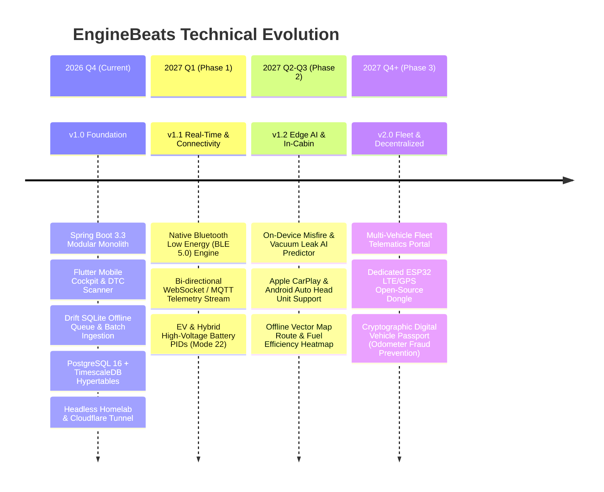
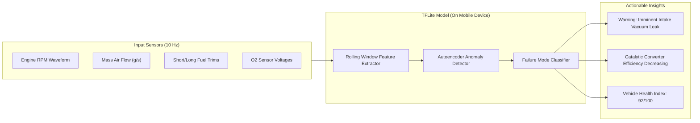

# EngineBeats Product & Technical Roadmap: Future Updates

This document outlines the strategic vision, architectural roadmap, and upcoming milestone deliverables for **EngineBeats**. It serves as the single source of truth for upcoming product iterations, edge AI capabilities, protocol expansions, and hardware integrations.

---

## 1. Roadmap Overview & Strategic Vision

---

## 2. Phase 1: High-Frequency Telemetry & Extended Hardware (v1.1)

### 2.1 Native Bluetooth Low Energy (BLE 5.0) Driver
- **Goal**: Expand beyond Wi-Fi / TCP adapters to support modern, low-power Bluetooth OBD-II dongles without manual pairing dialogs.
- **Hardware Targets**:
  - OBDLink CX (optimally tuned for BLE mobile apps)
  - vLinker MC+ / FS (supports high-speed CAN framing)
  - Carista BLE adapter
  - Generic ELM327 BLE 4.0/5.0 devices
- **Technical Implementation**:
  - Leverage native CoreBluetooth (iOS) and Android BLE GATT client.
  - Implement dynamic MTU negotiation (up to 512 bytes) to transmit complete multi-frame ECU diagnostic responses in a single BLE packet.
  - Zero-latency auto-reconnect background service when the driver enters the vehicle.

### 2.2 Sub-Second Real-Time Streaming (WebSocket / MQTT)
- **Goal**: Allow remote viewers (e.g. race engineers, fleet managers, or personal web dashboard) to observe live dashboard gauges with $<100\text{ ms}$ latency.
- **Technical Implementation**:
  - Introduce Spring Boot STOMP over WebSockets endpoint at `/ws/telemetry`.
  - MQTT broker integration (Eclipse Mosquitto) for battery-efficient mobile-to-cloud telemetry transmission.
  - Granular pub/sub topics partitioned by vehicle ID: `vehicles/{vehicleId}/telemetry/live`.

### 2.3 Extended OEM & Electric Vehicle (EV) Telemetry (UDS / Mode 22)
- **Goal**: Go beyond generic SAE J1979 Mode 01 emission PIDs to support modern electric, hybrid, and diesel vehicles.
- **Supported Extended Metrics**:
  - **EV / Hybrid**: High-voltage traction battery State of Health (SoH %), individual cell voltage balance, inverter temperature, regenerative braking torque.
  - **Internal Combustion Engine (ICE)**: Individual tire pressure monitoring (TPMS), transmission fluid temperature, oil degradation percentage, diesel particulate filter (DPF) soot load.
  - Support for **ISO 14229 (Unified Diagnostic Services - UDS)** via Mode 22 custom PID definitions.

---

## 3. Phase 2: Edge AI, Infotainment & Route Intelligence (v1.2)

### 3.1 On-Device Predictive Maintenance (Edge AI Engine)
- **Goal**: Detect engine and component degradation **weeks before** the Check Engine light (MIL) illuminates.
- **Model Architecture**:
  - Lightweight TensorFlow Lite / ONNX model running directly on the smartphone.
  - **Fuel Trim Drift Analysis**: Analyzes short-term vs. long-term fuel trim variance (`SHRTFT1` and `LONGFT1`) combined with Mass Air Flow (`MAF`) to detect vacuum leaks, unmetered air, or failing oxygen sensors.
  - **RPM Waveform Spectral Analysis**: Detects subtle rotational crankshaft velocity oscillations to identify cylinder-specific micro-misfires before standard ECU thresholds trip code `P0300`–`P0308`.

### 3.2 Apple CarPlay & Android Auto In-Dash Integration
- **Goal**: Safely display real-time gauges, shift lights, and eco-scores directly on the vehicle's infotainment touchscreen.
- **Features**:
  - Native CarPlay Navigation and Template framework integration.
  - Android Auto Car App Library integration.
  - Heads-Up Display (HUD) projection mode: flips the smartphone screen horizontally for reflection onto the windshield during night driving.

### 3.3 Offline Vector Maps & Route Correlated Efficiency Heatmaps
- **Goal**: Correlate diagnostic data with physical road geometry without requiring active data connections.
- **Features**:
  - Offline vector tiles using MapLibre GL.
  - Color-coded GPS route lines illustrating fuel economy, hard braking events, high lateral G-forces, and throttle aggression.
  - Elevation correlation: automatically adjusts expected fuel consumption based on uphill/downhill topographical inclines.

---

## 4. Phase 3: Autonomous Fleet Management & Hardware (v2.0)

### 4.1 Multi-Vehicle Fleet Management Portal
- **Goal**: Expand EngineBeats from an individual driver tool into an enterprise-ready fleet monitoring platform.
- **Features**:
  - Live multi-vehicle map with real-time GPS locations and vehicle status (Driving, Idling, Parked, Fault Code Detected).
  - Automated Driver Safety Scorecards based on harsh acceleration, rapid deceleration, and high-speed cornering.
  - Scheduled preventive maintenance calendars triggered by cumulative vehicle mileage.
  - Automated PDF fleet compliance and carbon footprint emissions reports.

### 4.2 Dedicated Open-Source Hardware Dongle (EngineBeats Link)
- **Goal**: Eliminate the requirement for drivers to launch the mobile app every time they drive.
- **Hardware Architecture**:
  - Microcontroller: Espressif ESP32-S3 (Dual-core 240 MHz, Wi-Fi & BLE).
  - CAN Transceiver: SN65HVD230 / MCP2515 interface directly connected to OBD-II Pins 6 & 14.
  - Connectivity: Quectel LTE Cat-M1 / NB-IoT modem with GNSS GPS positioning.
  - Power: Ultra-low-power sleep mode ($<2\text{ mA}$) triggered by vehicle voltage drop when the engine shuts off, preventing vehicle 12V battery drain.
  - Direct cloud telemetry transmission via encrypted MQTT over TLS.

### 4.3 Cryptographic Vehicle Digital Passport
- **Goal**: Prevent odometer tampering and provide transparent, verified service records when buying or selling used cars.
- **Implementation**:
  - Key diagnostic milestones (odometer readings, DTC occurrence timestamps, emission readiness status) are cryptographically hashed and digitally signed.
  - Buyers can scan a vehicle QR code to verify uninterrupted diagnostic telemetry history.

---

## 5. Architectural & Infrastructure Scaling Roadmap

As the platform scales to tens of thousands of streaming vehicles, the backend architecture will evolve according to the following benchmarks:

| Ingestion Scale | Primary Bottleneck | Architectural Solution |
|---|---|---|
| **0 – 1,000 Vehicles** *(Current)* | Single-node PostgreSQL I/O | PostgreSQL 16 + TimescaleDB 7-day chunk hypertable with local Caddy reverse proxy. |
| **1,000 – 25,000 Vehicles** | Synchronous REST API thread saturation | Introduce **Apache Kafka** or **RabbitMQ** ingest buffer between API Gateway and TimescaleDB consumers. |
| **25,000 – 100,000+ Vehicles** | Time-series query latency for analytics | Transition cold telemetry storage ($>90$ days) to **Apache Parquet on S3/MinIO** queried via **DuckDB** or **ClickHouse**; enable TimescaleDB automated continuous aggregates. |

---

## 6. Release Schedule & Milestone Targets

| Release | Codename | Target Release | Key Deliverables |
|---|---|---|---|
| **v1.0** | *Ignition* | **Released** | Spring Boot modular monolith, Keycloak OIDC, Flutter Cockpit, SQLite offline sync, ELM327 emulator, Homelab guide. |
| **v1.1** | *TelemetryStream* | **Q1 2027** | Native BLE 5.0 adapter engine, sub-second WebSocket telemetry, UDS/Mode 22 EV battery monitoring. |
| **v1.2** | *PredictiveDrive* | **Q2-Q3 2027** | On-device TFLite predictive maintenance, Apple CarPlay / Android Auto, MapLibre route heatmaps. |
| **v2.0** | *FleetPulse* | **Q4 2027** | Enterprise fleet management dashboard, open-source ESP32 hardware dongle, digital service passport. |
